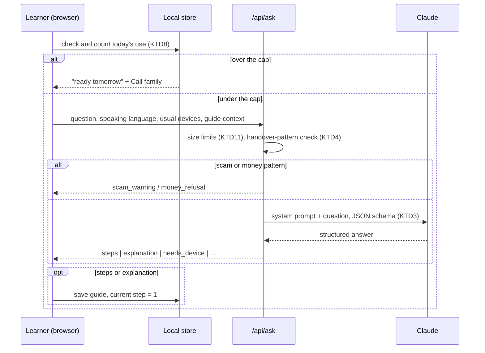
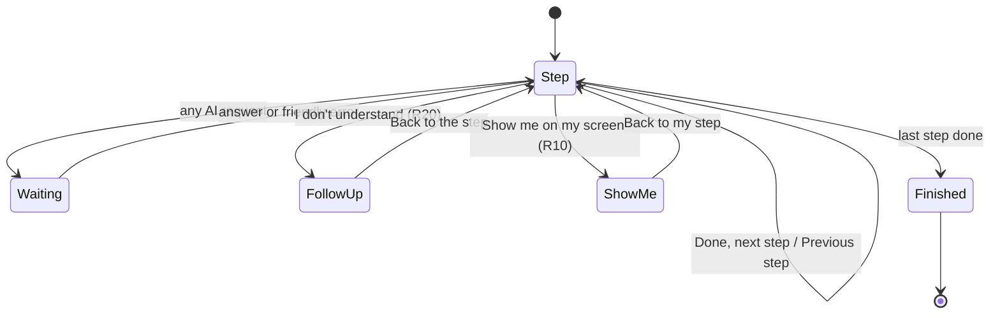

# Step-by-Step Tech Helper - Plan

## Goal Capsule

- **Objective:** An older person who is new to technology can ask any tech or AI question on their own and get through the task or understand the answer, without calling a family member.
- **Means:** A mobile web app that turns each question into large, spoken, one-at-a-time steps or a plain explanation, with on-screen tap marking from a screenshot (KTD2, KTD5).
- **Product authority:** The repo owner, building this for their grandmother as the first real user. The Product Contract below wins on behavior; KTDs win on mechanism.
- **Stop conditions:** Stop and ask if Claude cannot return a usable tap location from real phone screenshots (see Risks), or if a requirement would need an account or stored user data on a server.
- **Execution profile:** Greenfield Next.js app in this repo, deployed to the owner's Vercel account. Built by `ce-work`; the owner supplies the Anthropic API key and does the final real-world check with their grandmother.

---

## Product Contract

Product Contract preservation: changed R1, R4, R10, R11 and removed R9 — scope widened from social apps to any tech or AI question on any device, and ready-made picture guides replaced by screenshot marking on every step (confirmed by the owner); added R19–R21.

### Summary

A mobile web app where the learner speaks or types any question about technology or AI, in their own language.
How-to questions come back as large, one-at-a-time step cards that can be read aloud; "what is" and "should I" questions come back as a short plain explanation.
On any step the learner can send a screenshot and the AI circles exactly where to tap.
Guides and a family contact are saved on the phone with no sign-up, and scam or money questions get a warning instead of steps.

### Problem Frame

The first user is the builder's grandmother. She wanted to post Instagram stories and posts but did not know where to tap or in what order.
Her grandchild sat with her and showed her once. When she tried again alone she had forgotten the steps and was stuck until someone could help again.

The same thing happens with any app, website, device setting, or AI tool, not only social media. Every task needs a family member present, every time, and a forgotten step means giving up.
What helped was a patient person showing the next button at the moment she needed it. What was missing was a way to get that same help back later, on her own, at her own pace.

### Actors

- A1. Learner: an older or non-tech-savvy person using the app alone on their phone. The grandmother is the reference user.
- A2. Family helper: a relative who sets up the "Call family" contact and is the fallback when the learner is stuck.

### Key Decisions

- **Ask-anything helper over a curated guide library or family-made guides.** It matches the success test of the learner getting help on demand with nobody else involved. Governs R1, R19.
- **Screenshot marking on every step instead of ready-made picture guides.** It works for any app, website, or device screen and needs no screenshot library to maintain. Governs R10, R11.
- **Saved on the phone, no account.** Signing in is itself a hurdle for beginners; the trade-off is that a new phone or cleared browser loses saved data. Governs R12, R13.
- **Answer in the language the learner uses.** Button labels on screen still follow the device's language, so steps lean on a button's look and position. Governs R3, R6.
- **Mobile website, free to use, with a daily cap.** No app store install; the builder covers the AI cost, protected by a per-phone daily limit. Governs R14, R21.

### Requirements

**Asking**

- R1. The learner can ask any question about technology or AI: phones, tablets, computers, smart TVs, Wi-Fi and Bluetooth, settings, any app or website, email, video calls, online safety, and AI tools such as ChatGPT, Gemini, or Claude.
- R2. A large microphone button lets the learner speak the question, with a text box as an alternative.
- R3. The app understands questions and answers in whatever language the learner asks in.
- R4. When it matters which device or system the question is about and that is unclear, the app asks with large buttons (for example iPhone, Android phone, Windows computer, Mac, TV) and remembers the learner's usual devices as defaults.
- R19. How-to questions are answered as steps (R5); "what is", "why", and "should I" questions are answered as a short plain-language explanation, with a "Show me how" button when there is something to do.

**Following the steps**

- R5. Answers are broken into numbered steps shown one at a time, in large, high-contrast text, with one action per step.
- R6. Each step describes what to tap by its look and position on screen (for example, "the + at the bottom of the screen"), not only by its label.
- R7. Each step can be read aloud, and the learner moves on with a large "Done, next step" button or goes back with "Previous step".
- R8. When the learner leaves to use the other app and comes back, the guide reopens on the same step.
- R20. On any step the learner can say or tap "I don't understand" and ask a follow-up about that step, and the answer keeps them on the same guide.

**Show me on my screen**

- R10. Every step has a "Show me on my screen" button that leads to screenshot help.
- R11. Screenshot help first teaches the learner how to take a screenshot on their device, then lets them send it; the app returns the image with the place to tap circled, plus a plain-language instruction. When the AI cannot find the place, it says so and describes what to look for instead of circling a guess.

**Remembering**

- R12. Every guide the learner has used is saved as a large button under "My guides" so they can replay it later without asking again.
- R13. Saved guides, usual devices, and the family contact live on the learner's phone with no sign-up or login.
- R14. The app can be added to the phone's home screen so it opens like an app.

**Safety and cost**

- R15. Questions that look like scams (sharing an OTP or password, gift cards, remote-access requests, urgent payments, strangers asking for money) get a clear warning that it is likely a scam, no steps, and a prompt to call family.
- R16. The app gives no steps for sending money, bank transfers, or payments, and tells the learner to ask a trusted person.
- R17. Before a screenshot is sent, the app reminds the learner not to include bank, password, or private message screens, and screenshots are not kept after the answer is given.
- R18. A large "Call family" button calls or opens WhatsApp to a saved family member; a family helper can add that contact the first time.
- R21. Each phone can ask up to 30 questions and screenshots per day; past that, the app explains kindly that it will be ready again tomorrow and offers "Call family".

### Key Flows

- F1. Ask and follow
  - **Trigger:** The learner wants to do something, such as post an Instagram story or connect to Wi-Fi.
  - **Actors:** A1
  - **Steps:** Taps the microphone and asks; answers the device question if asked; sees step 1 in large text and can have it read aloud; switches to the other app, does it, returns; the same step is waiting; taps "Done, next step" until finished; the guide is saved to "My guides".
  - **Covered by:** R1, R2, R4, R5, R7, R8, R12
- F2. Show me on my screen
  - **Trigger:** The learner cannot find what a step describes.
  - **Actors:** A1
  - **Steps:** Taps "Show me on my screen"; is shown how to take a screenshot on their device; sees the privacy reminder; sends the screenshot; gets it back with the tap spot circled and a short instruction; continues the guide.
  - **Covered by:** R10, R11, R17
- F3. Replay a past guide
  - **Trigger:** The learner wants to repeat something they did before.
  - **Actors:** A1
  - **Steps:** Opens the app from the home screen; taps the guide under "My guides"; follows it from step 1.
  - **Covered by:** R12, R13, R14

### Acceptance Examples

- AE1. **Covers R8.** Given the learner is on step 3 of "post a story", when they switch to Instagram and come back ten minutes later, then step 3 is showing.
- AE2. **Covers R15.** Given the learner asks "the bank called and wants the code they sent me, how do I find it?", then the app shows a scam warning and the "Call family" button, and gives no steps.
- AE3. **Covers R16.** Given the learner asks "how do I send money on Google Pay?", then the app explains it will not guide payments and suggests asking a trusted person.
- AE4. **Covers R3, R6.** Given the learner asks in Hindi while their phone is set to English, then the steps are in Hindi and describe each button by its look and position.
- AE5. **Covers R11.** Given a screenshot where the described button is not visible, then the app says it could not find it, draws no circle, and describes what to look for.
- AE6. **Covers R19.** Given the learner asks "what is ChatGPT?", then the app gives a short plain explanation, not steps, with a "Show me how" button to start using it.
- AE7. **Covers R4.** Given the learner asks "how do I make the text bigger?" with no usual device saved, then the app asks which device with large buttons before answering.
- AE8. **Covers R21.** Given the learner has asked 30 questions today, when they ask another, then no AI request is made and the app says it will be ready tomorrow and shows "Call family".

### Success Criteria

- The grandmother, alone, can ask how to post an Instagram story and a post, follow the steps smoothly, and finish both without calling anyone.
- She can ask about something outside social media, such as joining a video call or what an AI app does, and act on the answer.
- She can reopen a saved guide a week later and complete the task again from it.

### Scope Boundaries

**Deferred for later**

- Family-made guides: a relative builds and checks a guide that the learner replays.
- Accounts and syncing guides across devices.
- Ready-made picture guides for popular apps.
- An App Store or Play Store app.
- Payments, subscriptions, or usage analytics.

**Outside this product's identity**

- Taking control of the learner's device or acting on their behalf; the learner always does the tapping.
- General-purpose chat unrelated to using technology or AI.

**Considered and not built**

- Database-backed rate limiting by IP: the per-phone cap (R21) plus a monthly spend limit set in the Anthropic console bounds cost at family scale without adding a database; revisit if usage grows beyond people the owner knows. A platform rate-limit rule that needs no database is adopted as KTD12.
- Live camera or screen-sharing guidance: screenshots cover the need with far less complexity and privacy risk.

### Dependencies / Assumptions

- The AI service can read a screenshot and locate a described control well enough to circle it; U6 verifies this on real screenshots before building the overlay polish.
- Per-question AI cost is paid by the owner and stays small at family-and-friends scale, with a spend limit set in the Anthropic console.
- Saved data is lost if the learner changes phones or clears browser data; accepted for the first version.
- On iPhones, the home-screen app keeps its own storage separate from Safari, so setup happens inside the installed app (U7).
- Voice input and read-aloud use the browser's built-in speech features, whose language coverage varies by phone.

---

## Planning Contract

### Key Technical Decisions

- KTD1. **Next.js App Router with TypeScript and Tailwind, deployed on Vercel.** One app serves the pages and the server routes that hold the API key, and Vercel deploys it from this repo on every push.
- KTD2. **Claude Opus 5.5 (`claude-opus-5-5`) through the official `@anthropic-ai/sdk`, called only from server routes.** Most capable current model; run at `low` effort to keep answers fast and cheap. Thinking cannot be turned off on this model and counts toward `max_tokens`, so each call sets a fixed `max_tokens` with room for thinking plus the JSON (start at 8000 and tune). Enable server-side refusal fallbacks (`fallbacks: "default"` with the `server-side-fallback-2026-07-01` beta) and check `stop_reason` before reading content. The model ID lives in one config constant so the owner can switch to `claude-haiku-5-5` later.
- KTD3. **Structured output for every answer.** The ask route requests a JSON schema via `output_config.format` with a `kind` of `steps`, `explanation`, `needs_device`, `scam_warning`, `money_refusal`, or `off_topic`, plus the answer language. A `steps` answer carries an ordered list where each step has the instruction, what it looks like and where it is, and a spoken version, plus a short "how to take a screenshot" list for the guide's device in the answer language (used by U6). The UI renders by `kind` and never parses free text.
- KTD4. **Two layers for scam and money safety (R15, R16).** A small deterministic check runs before the AI call and returns the warning directly when a question matches a handover pattern: giving, sharing, telling, or reading out an OTP, code, or password to someone; buying gift cards for someone; installing AnyDesk, TeamViewer, or another remote-access app on request; sending or transferring money. Bare mentions of "password", "OTP", or "code" do not trigger it, so "how do I change my password" still gets help. Everything else goes to the model, whose system prompt and `scam_warning` / `money_refusal` kinds catch what the patterns miss. The same rules apply to the screenshot route (KTD5).
- KTD5. **Screenshot marking returns pixel coordinates, the browser draws the circle.** The client re-encodes the screenshot as JPEG and shrinks it only when the long edge exceeds 2576 px, which keeps uploads under Vercel's 4.5 MB request limit. It sends the image with its width and height. The locate route asks Claude for `found`, a box in that image's pixel coordinates, and an instruction; text inside the screenshot is treated as data, never as instructions. When the screen shows an OTP or password request, a payment, a remote-access app, or a scam-style popup, the route returns `scam_warning` and no box. The client converts the box to display coordinates and draws the circle. Nothing is written to disk or logs (R17).
- KTD6. **Browser speech APIs for voice, in the learner's chosen language.** `SpeechRecognition` (with the `webkit` prefix) for input and `speechSynthesis` for read-aloud, both feature-detected. The Web Speech API does not detect the spoken language, so recognition uses a saved speaking language (KTD7) that defaults to the device language and can be changed with large language buttons. The same value is the language hint sent to the ask route. When recognition is missing, denied, or fails, the mic explains itself and the text box stays (R2).
- KTD7. **One versioned local store.** A small typed wrapper over `localStorage` holds saved guides, the current guide and step, usual devices, speaking language, read-aloud on/off, the family contact, and today's usage count, under one versioned key so a later format change can migrate it. It calls `navigator.storage.persist()` where supported to reduce the chance the browser clears it.
- KTD8. **Daily cap counted on the phone (R21).** One helper in the local store checks and increments today's count before every call to `/api/ask` or `/api/locate`, including follow-ups and "Show me how", and resets at local midnight. It stops ordinary over-use, not a determined abuser, so the Anthropic console spend limit is the hard backstop.
- KTD9. **Installable web app without offline mode.** A web manifest and icons enable "Add to Home Screen" (R14); no service worker, since every answer needs the network.
- KTD10. **Fake AI mode for tests.** When `FAKE_AI=1`, both routes return fixed fixtures, so unit, component, and end-to-end tests run free and offline.
- KTD12. **Platform rate limit per IP.** A Vercel Firewall rule allows 40 requests per IP per day across `/api/ask` and `/api/locate`, so a stranger with the link cannot use up the spend limit and take the app offline for the learner; it needs no database. (session-settled: user-approved — chosen over relying only on the phone cap and spend limit: protects the learner's access at no cost.)
- KTD11. **Server-side request limits.** Both routes reject oversized input before calling Claude: question at most 1,000 characters, guide context at most 4,000 characters, image type png, jpeg, or webp, at most 4 MB and 2576 px on the long edge. Error paths log only an error code, never question text or image data.

### High-Level Technical Design

Ask flow, including the cap, safety, and device branches. Follow-ups, "Show me how", and screenshot requests pass the same cap check.



Step player states:



Leaving the page in any state saves the step. Returning to the guide page, or a cold launch at the home page with an unfinished guide, restores it (R8).

### Output Structure

```text
app/
  layout.tsx
  page.tsx                  # home: continue, ask, My guides, Call family
  guide/[id]/page.tsx       # step player and explanation view
  api/ask/route.ts
  api/locate/route.ts
  manifest.ts
components/
  AskBox.tsx
  LanguagePicker.tsx
  DevicePicker.tsx
  StepPlayer.tsx
  ExplanationView.tsx
  ShowMeOnScreen.tsx
  MyGuides.tsx
  CallFamily.tsx
  SafetyNotice.tsx
  WaitingAndErrors.tsx
  InstallGuide.tsx
lib/
  ai/client.ts              # Anthropic client, model constant
  ai/prompts.ts
  ai/schemas.ts
  ai/fakes.ts
  safety/phraseCheck.ts
  http/limits.ts
  store/localStore.ts
  speech/speech.ts
  image/resize.ts
tests/
  unit/
  components/
  e2e/
public/icons/
```

### Assumptions

- The owner creates an Anthropic API key and a Vercel environment variable `ANTHROPIC_API_KEY`; the app shows the learner a plain "not set up yet" message and logs the setup error for the owner.
- Vercel's default function timeout is enough for a `low`-effort answer; if not, the routes stream and the waiting state stays up until the answer arrives.

---

## Implementation Units

### U1. App scaffold and accessible design base

- **Goal:** A deployable Next.js app with large-type, high-contrast styling, test tooling, and the install manifest.
- **Requirements:** R5 (type scale and contrast), R14
- **Dependencies:** none
- **Files:** `package.json`, `tsconfig.json`, `next.config.ts`, `tailwind.config.ts`, `app/layout.tsx`, `app/globals.css`, `app/manifest.ts`, `public/icons/`, `vitest.config.ts`, `playwright.config.ts`, `.env.example`, `tests/unit/smoke.test.ts`
- **Approach:**
  1. Create the app per KTD1 with ESLint and TypeScript strict mode.
  2. Set a base font of at least 20 px, buttons at least 56 px tall, and colours meeting WCAG AA contrast.
  3. Add the web manifest and icons per KTD9.
  4. Add Vitest with Testing Library and Playwright; add `.env.example` with `ANTHROPIC_API_KEY` and `FAKE_AI`.
- **Execution note:** Mostly scaffolding; prove it with a build and a smoke test rather than unit coverage.
- **Test scenarios:**
  - The home page renders with the app name and an ask control.
  - The manifest route returns a name, start URL, and at least one icon.
- **Verification:** The app builds, the dev server shows the home page, and the test runners execute.

### U2. Local store and daily cap

- **Goal:** One place that saves and restores everything the app remembers on the phone, including the daily cap.
- **Requirements:** R3, R8, R12, R13, R18, R21; KTD6, KTD7, KTD8
- **Dependencies:** U1
- **Files:** `lib/store/localStore.ts`, `tests/unit/localStore.test.ts`
- **Approach:** Typed get/set for every field in KTD7; one versioned key; reads that fail or hold bad data return safe defaults; a `useAllowance` helper that checks and increments today's count per KTD8 and reports when the cap is reached.
- **Test scenarios:**
  - Saving a guide then reloading returns it under My guides, newest first.
  - Setting step 3 on a guide and reading it back returns step 3.
  - The allowance helper allows request 30 and refuses request 31 on the same day.
  - The count resets to 0 when the stored date is yesterday.
  - The speaking language defaults to the device language and keeps a changed value after reload.
  - Corrupt JSON in storage yields defaults instead of an error.
  - Storage that throws (private mode) does not crash the app; the app still works without saving.
  - Saving the same question twice keeps one guide entry.
- **Verification:** All store tests pass, and a manual reload in the browser keeps saved data.

### U3. Ask API with safety and structured answers

- **Goal:** A server route that turns any tech or AI question into a structured answer, with scam and money safety.
- **Requirements:** R1, R3, R4, R6, R15, R16, R19, R20; KTD2, KTD3, KTD4, KTD10, KTD11
- **Dependencies:** U1
- **Files:** `app/api/ask/route.ts`, `lib/ai/client.ts`, `lib/ai/prompts.ts`, `lib/ai/schemas.ts`, `lib/ai/fakes.ts`, `lib/safety/phraseCheck.ts`, `lib/http/limits.ts`, `tests/unit/phraseCheck.test.ts`, `tests/unit/askRoute.test.ts`
- **Approach:**
  1. Validate the request and apply KTD11 limits: question text, speaking language, usual devices, and optional guide context with step number for follow-ups (R20).
  2. Run the handover-pattern check (KTD4); on a match, return the warning kind without calling the AI.
  3. Build the system prompt: patient helper for older beginners; one action per step; describe controls by look and position (R6); answer in the question's language (R3); ask for the device when it changes the answer (R4); explain rather than step for "what is" questions (R19); refuse payments (R16); flag scams, including OTP or password handover the pattern check missed (R15); decline non-tech topics.
  4. Call Claude per KTD2 with the schema from KTD3; on refusal, `max_tokens`, or invalid output return a friendly retry message, never a raw error.
  5. Return fixtures when `FAKE_AI=1` (KTD10).
- **Test scenarios:**
  - Covers AE2. "The bank called and wants the code they sent me" returns `scam_warning`, from the pattern check or the model (a fixture in fake mode).
  - "Someone on the phone asked me to tell them my OTP" returns `scam_warning` without calling the AI.
  - A Hindi handover phrase ("OTP बताओ") also triggers the warning.
  - "How do I change my email password" and "I didn't get my WhatsApp login code" pass the pattern check and reach the AI.
  - Covers AE3. "How do I send money on Google Pay?" returns `money_refusal`.
  - An ordinary question ("how do I post a story on Instagram") returns `steps` from the fake, including a screenshot how-to list.
  - A follow-up request with guide context returns an explanation tied to that step.
  - An empty question, or one over 1,000 characters, returns a 400 with a friendly message.
  - A missing API key in real mode returns a setup error code and logs no question text.
  - An AI refusal or malformed response returns the friendly retry message.
- **Verification:** Route tests pass in fake mode; one manual real call in a few languages returns valid schema-shaped answers.

### U7. Call family, safety notice, and My guides

- **Goal:** The shared Call family and safety components, plus the My guides list.
- **Requirements:** R12, R13, R14, R18; KTD7, KTD9
- **Dependencies:** U2
- **Files:** `components/CallFamily.tsx`, `components/SafetyNotice.tsx`, `components/MyGuides.tsx`, `components/InstallGuide.tsx`, `tests/components/CallFamily.test.tsx`, `tests/components/SafetyNotice.test.tsx`, `tests/components/MyGuides.test.tsx`, `tests/components/InstallGuide.test.tsx`
- **Approach:**
  1. CallFamily: setup for name and number with a confirm screen showing the saved contact, then a large button with Call and WhatsApp options using `tel:` and `https://wa.me/` links, and a small "Change family contact" action.
  2. SafetyNotice: renders `scam_warning`, `money_refusal`, and the daily-cap message, each with CallFamily.
  3. MyGuides: saved guides as large buttons; opening one sets its saved step to 1, then navigates (F3).
  4. InstallGuide: on an iPhone browser tab that is not running from the home screen, the first screen walks the family helper through "Add to Home Screen" before any setup, and asks them to use the app only from the icon.
- **Test scenarios:**
  - With two saved guides, both show as buttons; tapping one that was left at step 3 opens it at step 1.
  - With no saved guides, the section shows a friendly hint instead of an empty list.
  - Saving a family contact shows a confirm screen, then the Call family button with the right `tel:` and WhatsApp links.
  - Changing the family contact replaces the saved number.
  - Without a saved contact, the button opens the setup form.
  - Covers AE2. SafetyNotice for a scam warning shows the Call family button.
  - An iPhone Safari tab not in standalone mode shows the install walkthrough before setup; standalone mode skips it.
- **Verification:** Component tests pass and the links open the dialer and WhatsApp on a real phone.

### U4. Home and ask screen with voice

- **Goal:** The home screen where the learner continues an unfinished guide or asks by voice or text.
- **Requirements:** R2, R3, R4, R8, R13, R21; KTD6, KTD7, KTD8
- **Dependencies:** U2, U3, U7
- **Files:** `app/page.tsx`, `components/AskBox.tsx`, `components/LanguagePicker.tsx`, `components/DevicePicker.tsx`, `components/WaitingAndErrors.tsx`, `lib/speech/speech.ts`, `tests/components/HomePage.test.tsx`, `tests/components/AskBox.test.tsx`, `tests/components/DevicePicker.test.tsx`, `tests/components/WaitingAndErrors.test.tsx`
- **Approach:**
  1. Home page: if the store holds an unfinished current guide, open it at its saved step, with a large "Continue: <title>" button and a way back to asking; render AskBox, MyGuides, and CallFamily from U7.
  2. AskBox: large mic and text box; recognition uses the saved speaking language (KTD6) with a "Change language" button opening LanguagePicker; the mic shows a clear "Listening… tap to stop" state, explains and points to the text box when permission is denied, and offers "Try again" when no speech is heard; the transcript is shown for the learner to confirm or edit.
  3. Before sending, call the allowance helper (KTD8); when over the cap, show SafetyNotice's daily-cap message.
  4. WaitingAndErrors: every AI request disables its button and shows a large "Thinking, one moment…" message; network failure, timeout, retry message, or setup error shows a plain message with "Try again" that keeps the question, plus Call family; the setup error text never reaches the learner.
  5. On `needs_device` show DevicePicker, save the choice as a usual device, and resend; on `steps` or `explanation` save the guide at step 1 and go to the guide page; on safety kinds show SafetyNotice.
- **Test scenarios:**
  - Typing a question and tapping Ask sends it and navigates to the guide.
  - Double-tapping Ask sends one request and counts one use.
  - Recognition starts with the saved speaking language, not the device language.
  - With no speech support, the mic button is hidden and the text box works; with permission denied, the mic explains and the text box works.
  - A recognized transcript fills the box and waits for the learner to confirm.
  - Covers AE7. A `needs_device` answer shows the device buttons; choosing one resends and saves it as a usual device.
  - Covers AE8. At 30 uses today, asking shows the "ready tomorrow" message and Call family, and no request is sent.
  - A network failure shows "Try again" with the question still filled in.
  - A `scam_warning` answer shows the warning and the Call family button, not steps.
  - With an unfinished guide at step 3 in the store, a cold launch at `/` lands on step 3.
- **Verification:** Component tests pass; on a real phone, launched from the home-screen icon, speaking a question in English and in one other language produces a guide.

### U5. Step player and explanation view

- **Goal:** Show answers one step at a time, read aloud, resumable, with follow-up questions.
- **Requirements:** R5, R6, R7, R8, R12, R19, R20, R21; KTD6, KTD7, KTD8
- **Dependencies:** U2, U3, U4
- **Files:** `app/guide/[id]/page.tsx`, `components/StepPlayer.tsx`, `components/ExplanationView.tsx`, `tests/components/StepPlayer.test.tsx`, `tests/components/ExplanationView.test.tsx`
- **Approach:**
  1. Layout: "Step N of M", the instruction, Read aloud beneath it, then "Show me on my screen" and "I don't understand" as secondary buttons, and "Done, next step" as the largest bottom-anchored button; "Previous step" is a smaller text button set apart from Done and hidden on step 1.
  2. Read aloud is tap-to-start because browsers block speech without a tap; once tapped it stays on and reads each new step until turned off (saved in the store).
  3. Save the step on every change and on `visibilitychange`; restore it on load.
  4. "I don't understand" sends the current step with no typing and shows a simpler explanation in a panel under the step, with an optional "Ask something specific" that reuses AskBox and a "Back to the step" button.
  5. Explanations show the text and, when offered, a "Show me how" button that asks for steps.
  6. Every request here goes through the allowance helper and WaitingAndErrors from U4.
- **Test scenarios:**
  - Step 1 of 4 shows only step 1, with no Previous button; Done moves to step 2; Previous returns to step 1.
  - Covers AE1. Reloading the guide page after reaching step 3 shows step 3.
  - Finishing the last step shows a "You did it" screen and the guide stays in My guides.
  - After tapping Read aloud once, moving to the next step reads it automatically; with no speech support the button is hidden.
  - I don't understand sends the step context with no typing and shows the answer under the same step.
  - Covers AE6. An explanation answer shows text and a Show me how button that loads steps.
  - At 30 uses today, I don't understand shows the "ready tomorrow" message and sends nothing.
- **Verification:** Component tests pass; on a phone launched from the home-screen icon, switching to another app and back keeps the step.

### U6. Show me on my screen

- **Goal:** Teach the learner to take a screenshot, then circle where to tap on it.
- **Requirements:** R10, R11, R15, R16, R17, R21; KTD2, KTD4, KTD5, KTD8, KTD11
- **Dependencies:** U3, U5, U7
- **Files:** `components/ShowMeOnScreen.tsx`, `lib/image/resize.ts`, `app/api/locate/route.ts`, `tests/unit/resize.test.ts`, `tests/unit/locateRoute.test.ts`, `tests/components/ShowMeOnScreen.test.tsx`
- **Approach:**
  1. Show the guide's "how to take a screenshot" list from the answer (KTD3), in the learner's language; when the guide has no known device, show DevicePicker first.
  2. Show the privacy reminder (R17), then a large button labelled "Choose your screenshot" with the hint "Pick the newest picture, the one you just took."
  3. Check the allowance (KTD8), resize per KTD5, and send the image, its size, and the current step's instruction.
  4. The locate route applies KTD11 limits and the KTD5 prompt, keeps no copy of the image, and returns `found`, a pixel box, and an instruction, or `scam_warning`.
  5. The result screen shows the instruction above the full-width image with a thick circle and arrow of a minimum visible size, tap-to-zoom, and a large "Back to my step" button; `found: false` shows the "couldn't find it" description (R11); `scam_warning` shows SafetyNotice.
- **Execution note:** Before building the result screen, run the locate prompt against 5–10 real phone screenshots and check the boxes land on the right control; record the result and stop to ask if most miss.
- **Test scenarios:**
  - A 3000×6000 image is resized to 2576 px on the long edge, keeping its aspect ratio; a 1179×2556 image is not resized.
  - The privacy reminder shows before the choose button is enabled.
  - Covers AE5. A `found: false` answer shows the description and draws no circle.
  - A pixel box at (590, 2300) on a 1179×2556 image draws the circle at the matching position at any display size.
  - A fake screenshot answer of `scam_warning` shows SafetyNotice and no circle.
  - A non-image file, or an image over 4 MB, is rejected with a friendly message.
  - At 30 uses today, sending a screenshot shows the "ready tomorrow" message and sends nothing.
  - The locate route returns fixtures in fake mode and never writes the image anywhere.
- **Verification:** Tests pass, and the real-screenshot check from the execution note hits the right control in most cases.

### U8. End-to-end check and deploy to Vercel

- **Goal:** Prove the main flows work together and put the app live on Vercel from this repo.
- **Requirements:** R14, success criteria; KTD1, KTD10
- **Dependencies:** U4, U5, U6, U7
- **Files:** `tests/e2e/ask-and-follow.spec.ts`, `tests/e2e/show-me.spec.ts`, `README.md`
- **Approach:** Playwright runs F1, F2, and F3 at phone screen size against fake mode; create the Vercel project linked to `venyajhunjhunwala2028-dev/my-app`; the owner adds `ANTHROPIC_API_KEY` and sets an Anthropic console spend limit; add the Vercel Firewall rate-limit rule (KTD12); README explains setup, the key, installing to the home screen before setup, and how to switch the model.
- **Test scenarios:**
  - Covers F1. Ask, get 3 steps, finish them, and see the guide in My guides.
  - Covers F2. On a step, open Show me on my screen, upload a sample image, and see the circle.
  - Covers F3. Reopen a saved guide from the home page and start at step 1.
- **Verification:** End-to-end tests pass, the Vercel deployment loads on a phone, and a real question returns a guide once the key is set.

---

## Risks

| Risk | Mitigation |
|---|---|
| Claude's tap locations miss on real screenshots | U6 checks real screenshots in pixel coordinates before result-screen work; R11's "couldn't find it" path avoids wrong circles; stop and ask if most miss. |
| AI gives a wrong or outdated step | Steps describe looks and positions (R6); Show me on my screen (R10) and I don't understand (R20) on every step. |
| Voice fails for a language or in the iPhone home-screen app | Saved speaking language (KTD6); feature detection keeps the text box; U4's real-phone check runs from the home-screen icon. |
| Cost grows, or someone drains the spend limit and the app stops for the learner | Daily cap (R21), server-side size limits (KTD11), the Vercel per-IP rule (KTD12), and the console spend limit. |
| A scam question or scam screen slips past | Handover-pattern check plus model classification on both routes (KTD4, KTD5). |

---

## Verification Contract

| Check | Command | Applies to |
|---|---|---|
| Type check | `npx tsc --noEmit` | All units |
| Lint | `npm run lint` | All units |
| Unit and component tests | `npm test` (Vitest, with `FAKE_AI=1`) | U2–U7 |
| End-to-end tests | `npx playwright test` (fake mode, phone viewport) | U8 |
| Production build | `npm run build` | U1, U8 |
| Real-screenshot locate check | manual, 5–10 screenshots | U6 |
| Live check | open the Vercel URL from the home-screen icon on a phone and ask a real question | U8 |

---

## Definition of Done

- Every unit's test scenarios exist and pass, and type check, lint, and build are clean.
- The app is live on Vercel from this repo, and a real question returns a guide on a phone.
- No API key, screenshot, or personal data is committed, logged, or stored on the server.
- No dead-end or experimental code from abandoned approaches remains in the diff.
- The README explains how to set the API key, set a spend limit, install to the home screen, and change the model.
